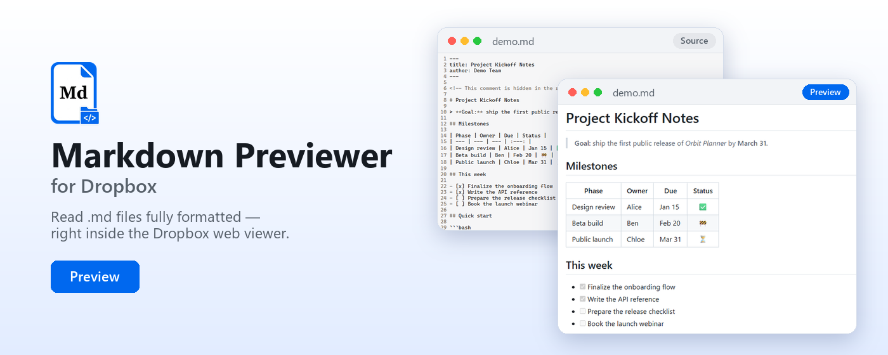
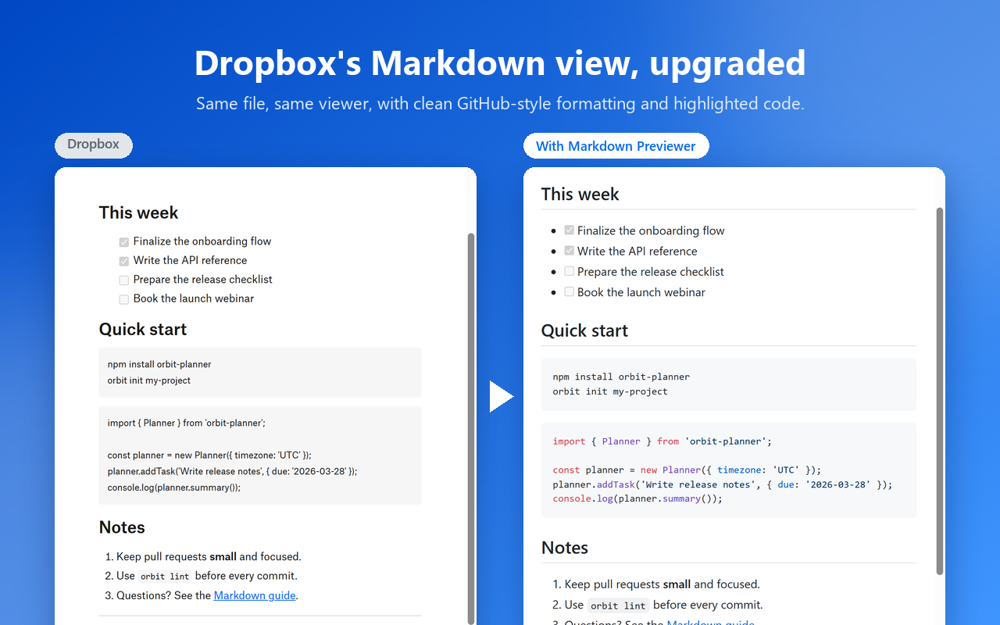
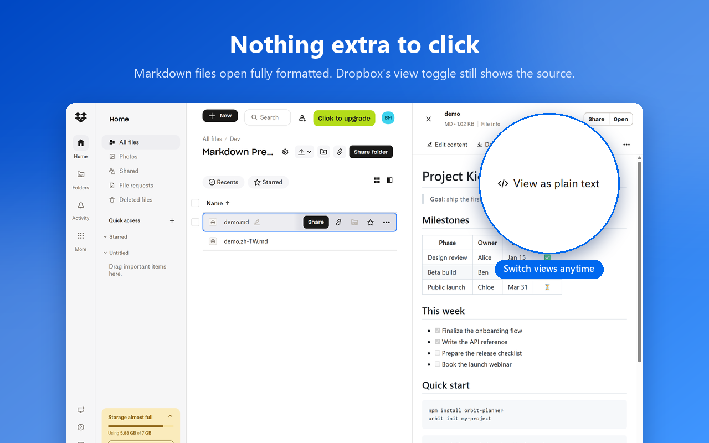
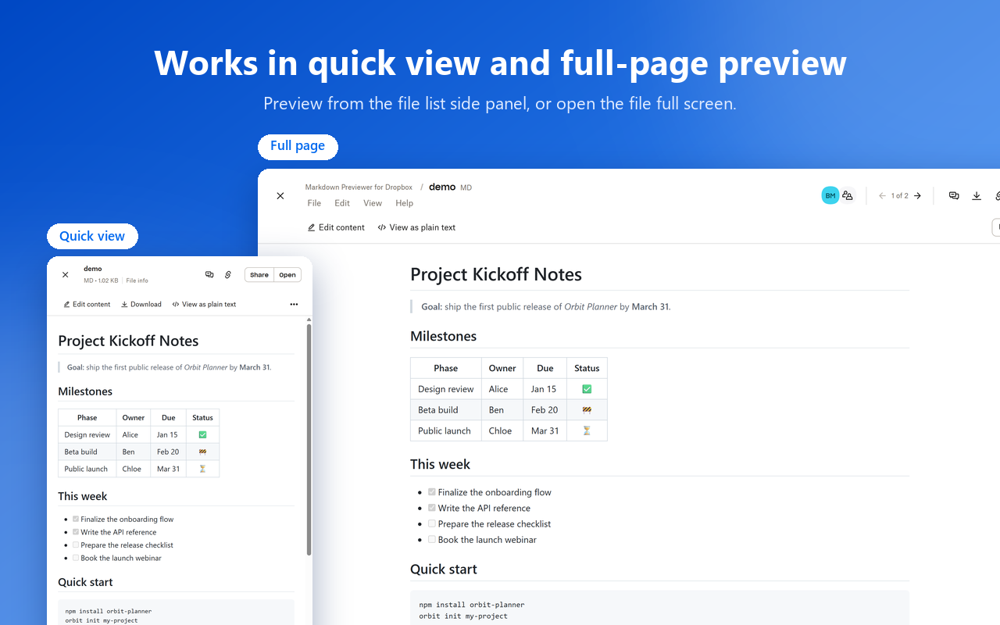
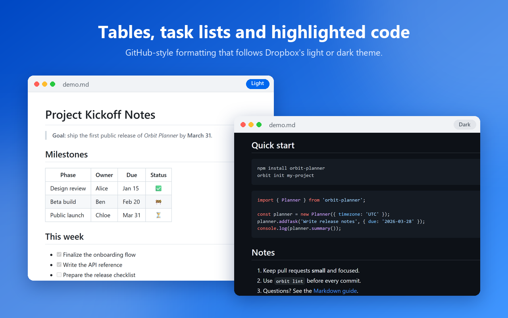

# Markdown Previewer for Dropbox

English | [繁體中文](README.zh-TW.md)



[](https://chromewebstore.google.com/detail/markdown-previewer-for-dr/mcmfjcocjahlihlalehjkfniibgbcbae)

A Chrome/Brave extension that improves how the Dropbox website displays Markdown files. When Dropbox shows a `.md` file in its Markdown view, the extension replaces Dropbox's rendering with clean GitHub-style formatting, syntax highlighting, and light/dark mode that follows Dropbox's theme. Dropbox's plain-text view is left unchanged, so you can still switch to the source with Dropbox's own view toggle.

It works in both places Dropbox shows a file:

- the quick-view side panel in the file list (`/home/...?quickview=...`)
- the full-page preview (`/home/...?preview=...md`)

## Screenshots

| | |
| --- | --- |
|  |  |
|  |  |

## Install

### From the Chrome Web Store (recommended)

Install **[Markdown Previewer for Dropbox](https://chromewebstore.google.com/detail/markdown-previewer-for-dr/mcmfjcocjahlihlalehjkfniibgbcbae)** from the Chrome Web Store. It works in Chrome, Brave and other Chromium-based browsers, and updates automatically.

Then open a `.md` file on dropbox.com. In Dropbox's Markdown view it is shown with the extension's formatting; switch Dropbox to its plain-text view to see the source.

### From source

1. Download the zip from [Releases](https://github.com/brianmaxwell515/Markdown-Previewer-for-Dropbox/releases) and unzip it, or clone this repository.
2. Open `chrome://extensions` (or `brave://extensions`).
3. Turn on **Developer mode**.
4. Click **Load unpacked** and select the folder.

## Package for the Chrome Web Store

```powershell
powershell -ExecutionPolicy Bypass -File .\build.ps1
```

This creates `dist/markdown-previewer-for-dropbox-<version>.zip` with only the files the extension needs. Bump `version` in `manifest.json` before building an update. Listing text and images are in [store/](store/).

## Privacy

The extension does not collect, store or send any data. See the [privacy policy](PRIVACY.md).

## How it works

- Dropbox's viewer downloads the original file from `previews.dropbox.com/p/orig/.../p.md`. The content script watches for that request with a `PerformanceObserver` and fetches the same URL with your session.
- The fetched text is checked against the lines Dropbox shows on screen. If it doesn't match, or the fetch fails, the extension renders the text from the page instead.
- Markdown is rendered with [marked](https://github.com/markedjs/marked), sanitized with [DOMPurify](https://github.com/cure53/DOMPurify) and highlighted with [highlight.js](https://highlightjs.org/), using [github-markdown-css](https://github.com/sindresorhus/github-markdown-css). All of them are bundled in `lib/`, because Manifest V3 doesn't allow remote code.
- The UI lives in a Shadow DOM, so its styles don't clash with Dropbox's.

## Limitations

- Relative image paths inside the Markdown (``) are not resolved against the Dropbox folder.
- The extension relies on Dropbox's `data-testid="fvsdk_text_preview"` and `fvsdk_preview_content` attributes. If Dropbox changes its viewer, update the selectors at the top of `content.js`.
