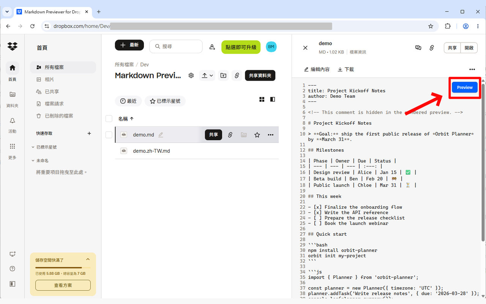
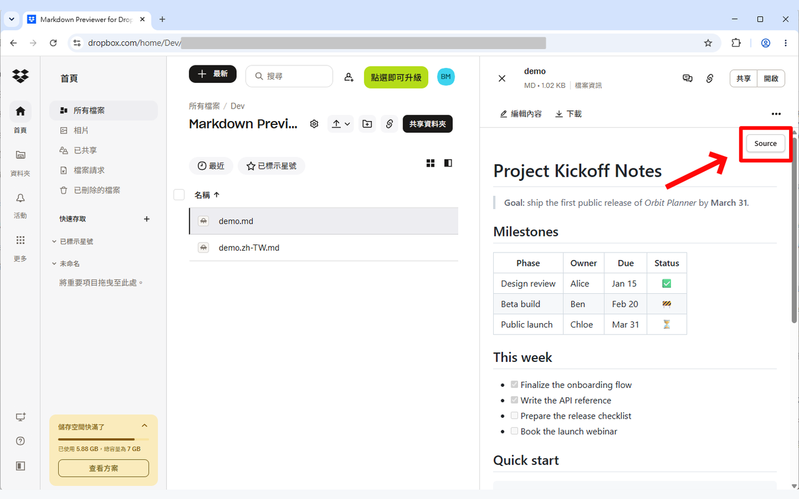
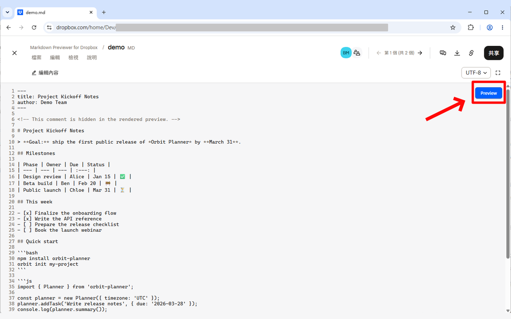
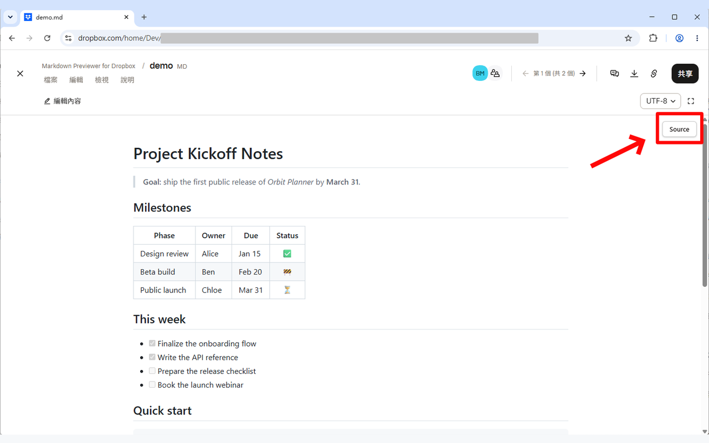

# Markdown Previewer for Dropbox

English | [繁體中文](README.zh-TW.md)


A Chrome/Brave extension that adds a **Preview** button to the Dropbox web file viewer. It renders `.md` / `.markdown` files as formatted Markdown, with GitHub styling, syntax highlighting and automatic light/dark mode.

It works in both places Dropbox shows a file:

- the quick-view side panel in the file list (`/home/...?quickview=...`)
- the full-page preview (`/preview/...md`)

## Screenshots

| | Source | Preview |
| --- | --- | --- |
| Quick view |  |  |
| Full page |  |  |

## Install

1. Open `chrome://extensions` (or `brave://extensions`).
2. Turn on **Developer mode**.
3. Click **Load unpacked** and select this folder.
4. Open a `.md` file on dropbox.com and click **Preview** at the top right of the viewer. Click **Source** to go back.

## Package for the Chrome Web Store

```powershell
powershell -ExecutionPolicy Bypass -File .\build.ps1
```

This creates `dist/markdown-previewer-for-dropbox-<version>.zip` with only the files the extension needs. Bump `version` in `manifest.json` before building an update. Listing text and images are in [store/](store/).

## Privacy

The extension does not collect, store or send any data. See the [privacy policy](PRIVACY.md).

## How it works

- Dropbox's viewer downloads the original file from `previews.dropbox.com/p/orig/.../p.md`. The content script watches for that request with a `PerformanceObserver` and fetches the same URL with your session.
- The fetched text is checked against the lines Dropbox shows on screen. If it doesn't match, or the fetch fails, the extension renders the text from the page instead.
- Markdown is rendered with [marked](https://github.com/markedjs/marked), sanitized with [DOMPurify](https://github.com/cure53/DOMPurify) and highlighted with [highlight.js](https://highlightjs.org/), using [github-markdown-css](https://github.com/sindresorhus/github-markdown-css). All of them are bundled in `lib/`, because Manifest V3 doesn't allow remote code.
- The UI lives in a Shadow DOM, so its styles don't clash with Dropbox's.

## Limitations

- Relative image paths inside the Markdown (``) are not resolved against the Dropbox folder.
- The extension relies on Dropbox's `data-testid="fvsdk_text_preview"` and `fvsdk_preview_content` attributes. If Dropbox changes its viewer, update the selectors at the top of `content.js`.
